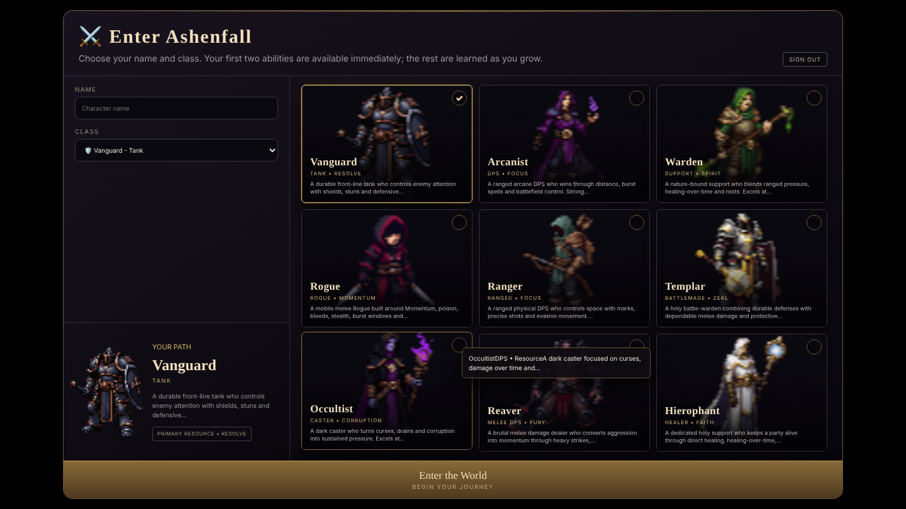
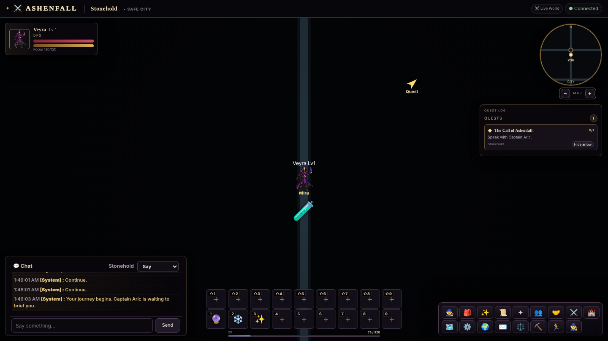
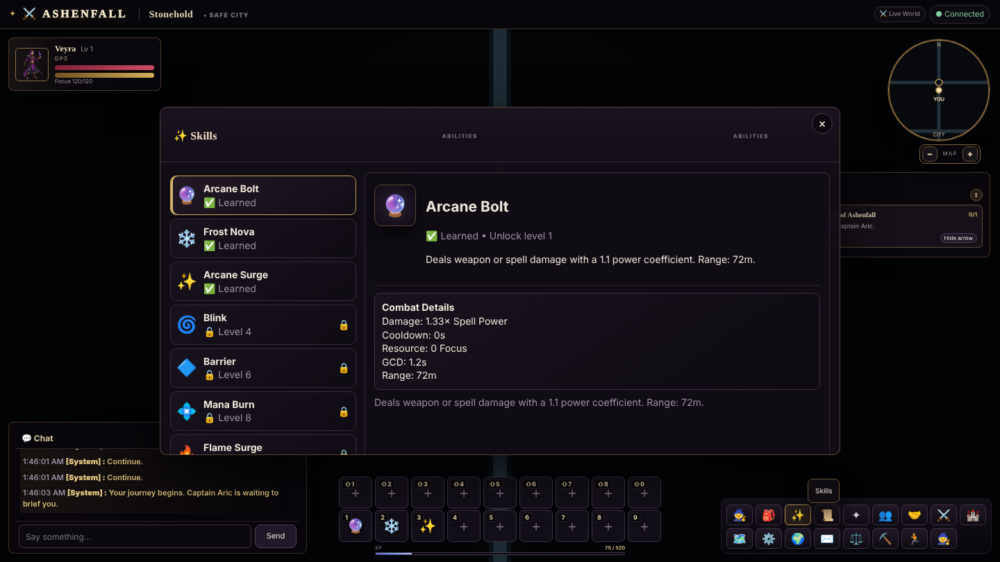
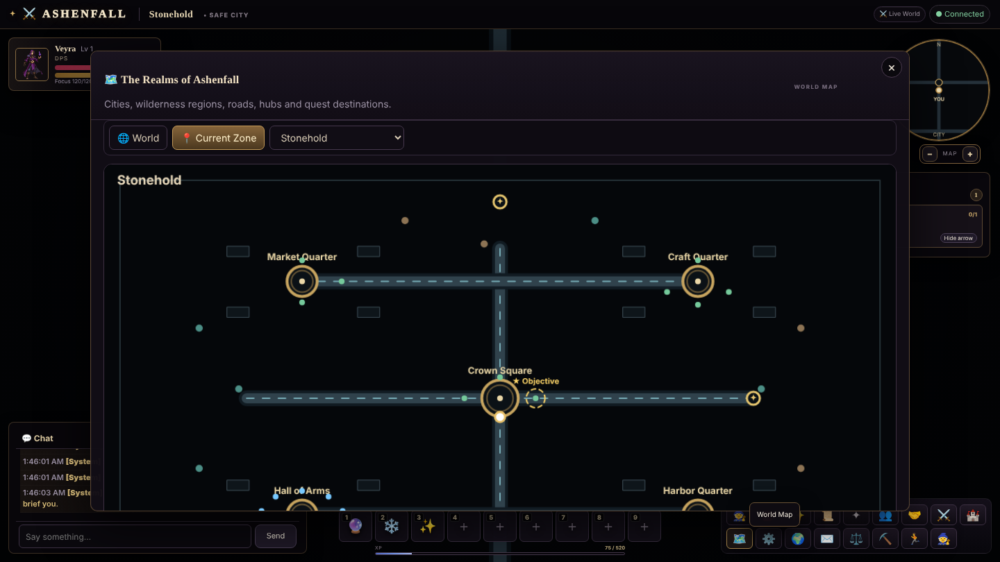
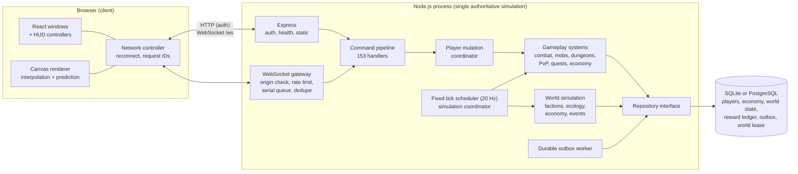
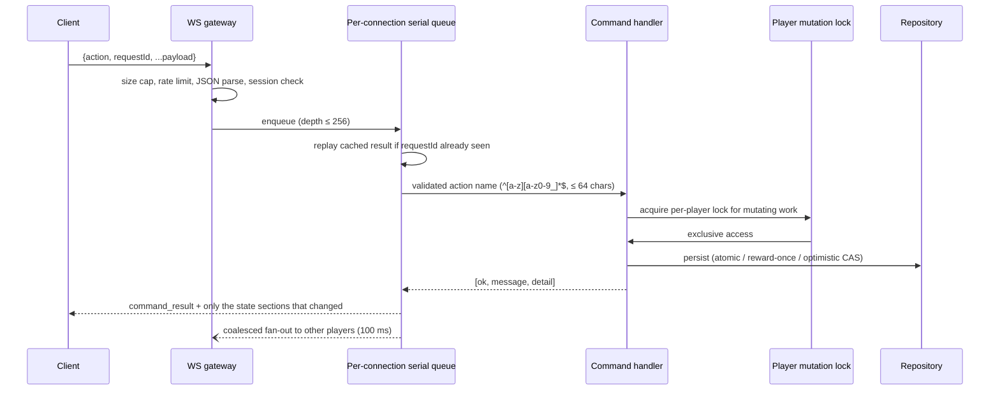

<div align="center">

# ⚔️ Ashenfall

**A browser-first, dark-fantasy multiplayer RPG with a server-authoritative world, real-time combat, persistent progression, dungeons, PvP, a player economy, and a living, event-sourced world simulation.**




</div>

---

## Table of Contents

1. [Overview](#overview)
2. [Feature Highlights](#feature-highlights)
3. [Screenshots](#screenshots)
4. [Technology Stack](#technology-stack)
5. [Architecture](#architecture)
   - [System Overview](#system-overview)
   - [Lifecycle of a Command](#lifecycle-of-a-command)
   - [The Authoritative Tick](#the-authoritative-tick)
   - [Concurrency Model](#concurrency-model)
   - [Persistence and Durability](#persistence-and-durability)
   - [Networking and State Synchronisation](#networking-and-state-synchronisation)
6. [Project Structure](#project-structure)
7. [Game Systems and Algorithms](#game-systems-and-algorithms)
   - [Combat](#combat)
   - [Mob AI and Encounters](#mob-ai-and-encounters)
   - [Dungeons, Matchmaking and PvP](#dungeons-matchmaking-and-pvp)
   - [Itemisation](#itemisation)
   - [Economy and Professions](#economy-and-professions)
   - [Progression, Quests and Story](#progression-quests-and-story)
   - [The Living World Simulation](#the-living-world-simulation)
8. [The Client](#the-client)
9. [Data-Driven Content](#data-driven-content)
10. [Getting Started](#getting-started)
11. [Configuration](#configuration)
12. [NPM Scripts](#npm-scripts)
13. [Deployment](#deployment)
14. [Security](#security)
15. [Testing and Quality Assurance](#testing-and-quality-assurance)
16. [Observability](#observability)
17. [Design Trade-offs and Known Limitations](#design-trade-offs-and-known-limitations)
18. [Contributing](#contributing)
19. [License](#license)

---

## Overview

Ashenfall is a persistent, multiplayer, top-down fantasy RPG that runs entirely in the browser and is powered by a single authoritative Node.js server. Players pick one of nine classes, explore a world of cities and wilderness regions, fight in real time, run five-tier dungeons, compete in arenas and battlegrounds, trade on an auction house, and progress from level 1 to 60 through a branching main story.

The project is built around three engineering ideas:

- **The server is the single source of truth.** Clients send _intent_ ("move here", "cast this ability on that target"); the server validates, simulates, and replies with state. Nothing the client says about its own health, position, inventory or rewards is trusted.
- **Durability is treated as a first-class concern.** Rewards are granted exactly once, multi-player operations are atomic, failed writes roll back in-memory state, and a fenced single-writer lease makes it impossible for two server processes to corrupt the same world.
- **The world keeps living.** Beyond per-player gameplay, a deterministic, event-sourced simulation drives factions, ecology, regional economies, trade caravans and emergent world events whether or not anyone is watching a given region.

**By the numbers**

|                        |                                                                                              |
| ---------------------- | -------------------------------------------------------------------------------------------- |
| Playable classes       | 9                                                                                            |
| Level cap              | 60 (six progression bands)                                                                   |
| Zone definitions       | 19 (5 cities, 7 PvE regions, 4 PvP regions, 3 instanced PvP maps)                            |
| Dungeons               | 5 dungeons × 5 difficulty tiers = 25 variants                                                |
| Abilities              | 177                                                                                          |
| Item definitions       | 2,500+ (plus procedurally generated gear instances)                                          |
| Quests                 | 211                                                                                          |
| NPCs                   | 47                                                                                           |
| Server command actions | 153                                                                                          |
| Server tick rate       | 20 Hz (50 ms)                                                                                |
| Source size            | ~13,000 lines of server code, ~5,000 lines of client code, ~3,000 lines of tests and tooling |

---

## Feature Highlights

**Gameplay**

- **Nine classes** with distinct resources and roles — Vanguard (Tank/Resolve), Arcanist (DPS/Focus), Warden (Support/Spirit), Shadowblade (Rogue/Momentum), Ranger (Ranged/Focus), Templar (Battlemage/Zeal), Occultist (Caster/Corruption), Reaver (Melee DPS/Fury) and Hierophant (Healer/Faith).
- **Real-time combat** with an attack table (miss, dodge, crit suppression), cast times, a global cooldown, ability queuing, projectiles, crowd control, diminishing returns, and threat-based aggro.
- **Talent trees, talent transformations, loadouts and class-specific resource, rotation and synergy systems.**
- **Dungeons** with room graphs, optional rooms, shortcuts, patrols, scripted events, reconnect grace periods, and boss encounters driven by an adaptive "director".
- **PvP**: duels, open-world PvP zones, rated 2v2 / 3v3 arenas with Elo-style MMR, and 5v5 battlegrounds grouped by level bracket.
- **Economy**: an auction house (bids, buyouts, fees, taxes, market analytics), an in-game mail system with attachments, NPC shops with buyback, secure player-to-player trading, and mining/crafting professions.
- **Social**: parties with role-aware matchmaking, friends, whispers, ignore lists, guilds with progression and organisation simulation.
- **Procedural itemisation**: rarities, quality tiers, affixes, sockets, gems, enchants, 81 item sets, legendary effects, upgrade levels, gear score, and pity-timer loot.
- **Narrative**: a main story with chapters and choices, per-class stories, lore discovery, and NPCs with memory and daily schedules.

**Engineering**

- Server-authoritative simulation on a drift-corrected fixed-timestep scheduler.
- Per-player asynchronous mutex with re-entrancy and deadlock-free multi-player locking.
- Exactly-once reward delivery via a durable reward ledger and a transactional outbox.
- Single-writer world lease with fencing tokens (SQLite and PostgreSQL).
- Optimistic concurrency control on persisted characters.
- Pluggable persistence (in-memory, SQLite via `node:sqlite`, PostgreSQL).
- Interest-managed motion streaming, snapshot interpolation and client-side prediction with server reconciliation.
- Fully data-driven content (≈4.8 MB of JSON) with startup validation.
- Extensive regression, fault-injection, fuzz, bot and full-journey test suites behind a single `npm run verify` gate.

---

## Screenshots

<table>
  <tr>
    <td width="50%"><br><sub><b>In-game HUD</b> — hotbar, minimap, quest tracker, chat and menu bar</sub></td>
    <td width="50%"><br><sub><b>Skills</b> — damage coefficients, cooldowns, GCD and range per ability</sub></td>
  </tr>
  <tr>
    <td colspan="2"><br><sub><b>World map</b> — hubs, roads, points of interest and quest objectives</sub></td>
  </tr>
</table>

> The game requires a viewport of at least **1360 × 560** pixels. Below that, the client blacks out and asks the player to enlarge the window or zoom out (see [The Client](#the-client)).

---

## Technology Stack

| Layer            | Technology                                                          | Notes                                                                               |
| ---------------- | ------------------------------------------------------------------- | ----------------------------------------------------------------------------------- |
| Runtime          | **Node.js ≥ 22.5**                                                  | Uses the built-in `node:sqlite` module, native `fetch`, and type stripping in tests |
| Language         | **TypeScript 5.8**                                                  | ES2022, `NodeNext` modules, ESM throughout                                          |
| HTTP             | **Express 5**                                                       | Auth API, health/readiness/metrics endpoints, static assets                         |
| Realtime         | **ws 8**                                                            | Single WebSocket per player, `ashenfall-v1` sub-protocol, JSON messages             |
| Persistence      | **SQLite** (`node:sqlite`, WAL) or **PostgreSQL** (`pg`)            | Selected at boot behind a common repository interface                               |
| Auth             | **bcrypt**, HMAC-SHA256 JWTs, HttpOnly cookies, **nodemailer**      | Email verification, password reset, guest accounts                                  |
| Client rendering | **HTML5 Canvas 2D**                                                 | Cached static world layer, interpolated entities                                    |
| Client UI        | **React 19** (via `createElement`, no JSX) + imperative controllers | Windows and menus are React; the HUD and input are controller-driven                |
| Bundling         | **esbuild**                                                         | Single ESM bundle for the browser                                                   |
| Hosting          | **Railway** (or any Node.js host) + managed PostgreSQL (e.g. Neon)  | No container required                                                               |
| Testing          | Plain Node scripts                                                  | No test framework dependency; suites run with `node`                                |

The production dependency footprint is deliberately small: **8 runtime packages** (`express`, `ws`, `pg`, `dotenv`, `nodemailer`, `bcrypt`, `react`, `react-dom`).

---

## Architecture

### System Overview



At boot the server loads the game catalogue, opens the repository, **acquires the world lease**, rehydrates every character into memory, migrates old character schemas, constructs every engine, and only then starts the tick scheduler and the HTTP/WebSocket listener. Everything that runs afterwards operates on an in-memory working set that is persisted through the repository.

### Lifecycle of a Command

Every player action — moving, casting, buying, accepting a quest — travels the same pipeline.



Key properties of this pipeline:

- **Whitelisted actions.** Only the 153 names in the command registry are executable; anything else returns `Unknown command.`
- **Per-connection serial execution.** A player's commands run strictly in order; a full queue (256) closes the socket with code `4429`.
- **Sliding-window rate limiting** (default 120 commands/second per connection, configurable) and a **64 KiB** message cap.
- **Idempotency.** Each command carries a client-generated `requestId`; a 256-entry / 30-second cache replays the original response for duplicates, so retries after a reconnect never double-apply.
- **Lightweight acknowledgements.** High-frequency commands (`move`, `move_input`, `stop`, target selection) skip full state serialisation.
- **Partial state.** Each command declares which state _sections_ it touches, so responses and broadcasts only carry what changed.

### The Authoritative Tick

A drift-corrected fixed-timestep scheduler runs the simulation every **50 ms**. Rather than `setInterval`, it computes the next deadline from the previous one so jitter does not accumulate; if the loop falls more than four intervals behind (for example after a long GC pause or a suspended VM) it resynchronises instead of trying to "catch up" with a burst of ticks.

Each tick, in abridged order:

1. **Housekeeping** — expire trade sessions, run economy cleanup, expire dungeon ready-checks.
2. **World simulation** — guild organisations, faction operations, regional economy and caravans, the event-sourced world ledger, emergent events, ecology, world-event phases.
3. **Matchmaking and PvP** — finish expired arenas/battlegrounds, attempt 2v2 and 3v3 matches, resolve expired loot rolls.
4. **Player-facing world systems** — region engine, discovery engine, open-world director (contracts, rare hunts), NPC schedules, player movement integration.
5. **Exploration rewards** — resolved asynchronously with stable reward keys so a retry can never pay twice.
6. **Combat** — per-player cast completion, ability queues and auto-attacks; world-combat simulation (mob AI, leashing, attacks, projectiles); encounter and dungeon ticks.
7. **Network** — publish motion snapshots (state fan-out is throttled separately).
8. **Persistence** — a periodic checkpoint every 5 seconds; tick duration, overruns and averages are recorded for telemetry.

Players whose state is currently locked by an in-flight command are **skipped for that tick** rather than mutated underneath the command, which preserves per-player consistency without stalling the loop.

### Concurrency Model

JavaScript is single-threaded, but `await` points interleave work, so the server still needs explicit exclusion.

- **`PlayerMutationCoordinator`** is a per-player FIFO mutex built from promise chains. It is **re-entrant** (an `AsyncLocalStorage` set records which keys the current async context already holds) and offers `withPlayers([...])`, which **sorts the keys before acquiring them**, giving a global lock order and eliminating deadlocks for multi-party operations such as trades, party loot and PvP settlement. `isLocked()` lets the tick skip busy players.
- **Economy locks.** The auction house layers its own seller- and auction-scoped locks over player locks so listing, bidding, buying and mail claims serialise correctly.
- **Snapshot → mutate → commit-or-restore.** Operations that grant value (quest turn-ins, exploration discoveries, listings, encounter victories) take a snapshot of the affected state, mutate in memory, attempt a **durable** commit, and on failure restore the snapshot. Retries are safe because commits are idempotent.
- **Deferred integration.** When a world-integration event targets a locked participant, it stays replayable and is applied exactly once after the lock releases.

### Persistence and Durability

All persistence goes through a single `PlayerRepository` interface with three implementations:

| Backend        | Intended use                           | Highlights                                                                                                                                                  |
| -------------- | -------------------------------------- | ----------------------------------------------------------------------------------------------------------------------------------------------------------- |
| **Memory**     | Unit tests and simulations             | Zero dependencies                                                                                                                                           |
| **SQLite**     | Local development, single-node hosting | `node:sqlite`, WAL journal, `synchronous=NORMAL`, 500 ms write-behind flush, per-row **revision** column for optimistic concurrency, 2 MB per-character cap |
| **PostgreSQL** | Production                             | `pg` pool, transactional multi-row saves using `SELECT … FOR UPDATE`, lease assertions inside every transaction                                             |

**Guarantees the repository provides**

- **Optimistic concurrency (CAS).** A character write is `UPDATE … WHERE id=? AND revision=?`. A stale writer is rejected and the character is quarantined until it is reloaded, rather than silently overwriting newer data.
- **Oversize protection.** A character exceeding the size limit is quarantined instead of corrupting the row; other characters keep saving normally.
- **Exactly-once rewards.** `savePlayerRewardOnce(player, rewardKey)` inserts the key into a `reward_ledger` table and saves the character in **one transaction**. If the key already exists the reward is a no-op. `savePlayersWithRewardsOnce` does the same for whole parties.
- **Transactional outbox.** Reward commits can enqueue a `durable_outbox` event in the same transaction. A background worker claims events (with a lock lease), applies their world-simulation consequences, and marks them complete — or reschedules them with **exponential backoff** (1 s doubling, capped at 5 min).
- **Atomic cross-entity saves.** Trades and auctions persist all involved players _and_ the economy state together (`savePlayersAndEconomyAtomically`).
- **Single-writer world lease with fencing tokens.** At boot the process acquires `ashenfall:global`; a second process waits up to 45 seconds for the holder to release it (graceful shutdown releases it immediately; a hard kill frees it when the 30 s TTL expires) and then exits if it is still held. The lease is renewed every 10 s (30 s TTL). Each acquisition increments a **fencing token**, and PostgreSQL writes assert the token inside the transaction, so a "zombie" process that lost its lease cannot write. On loss the server stops ticking, fences itself off, and closes sockets with code `4410`; it re-acquires automatically if possible.
- **Schema versioning and migration.** Repository metadata stores a schema version; `migrateCharacterSchema` upgrades older characters at boot.
- **Graceful shutdown.** `SIGINT`/`SIGTERM` checkpoint the economy, world simulation, chronicle and NPC memory before exit.

### Networking and State Synchronisation

- **Transport.** One WebSocket (`/ws`, sub-protocol `ashenfall-v1`) per client, authenticated from the HttpOnly access-token cookie during the upgrade. Origins are checked against the `Host` header plus an optional allow-list. Compression is disabled to protect CPU on the tick thread.
- **Two data paths.** (1) _State_ messages carry structured, sectioned game state, throttled to ~100 ms for broadcasts. (2) _Motion_ messages are small, frequent position/velocity packets with a monotonically increasing sequence number and a server timestamp.
- **Interest management.** Motion is filtered by distance (650 m for players and mobs) and capped (250 players / 120 mobs per packet), so bandwidth scales with local density rather than population.
- **Spatial index.** `PlayerSpatialIndex` is a uniform-grid hash (cell size 0.05 in normalised zone coordinates). Radius queries visit only neighbouring cells, then sort deterministically by squared distance with a stable tie-break and a result cap.
- **Fan-out coalescing.** Many commands in a short window are merged into one broadcast carrying the union of changed sections.
- **Session rules.** One active tab per account (`4411`), one active session per character (`4009`), replaced sessions are closed (`4409`), unauthenticated sockets are closed (`4401`), and a capacity cap protects the server (`4429`).
- **Liveness.** Server pings every 30 s and terminates unresponsive sockets; clients reconnect automatically.

---

## Project Structure

```
ashenfall/
├── client/                         Browser application (TypeScript → esbuild bundle)
│   ├── index.html                  Single-page shell (auth, creation, HUD, modals)
│   ├── style.css                   All styling
│   ├── app.ts                      Entry point
│   ├── ClientApplicationRuntime.ts Composition root that wires every controller together
│   ├── config/                     Client-side tunables
│   ├── runtime/                    Controllers: network, motion/prediction, interpolation,
│   │                               rendering, input routing, hotbar, chat, windows, tooltips,
│   │                               settings, viewport guard, authoritative-state store
│   ├── react/                      React 19 windows (bag, skills, talents, social, PvP, map…)
│   └── assets/                     Class portraits, boss art, cursors, world sprites (SVG/PNG)
│
├── server/                         Authoritative game server (TypeScript)
│   ├── index.ts                    Composition root: loads data, builds engines, starts runtime
│   ├── auth/                       Accounts, JWTs, guest sessions, email, rate limiter
│   ├── combat/                     Attack table, damage formulas, state machine, encounters, PvP
│   ├── content/                    Dynamic per-player item generation
│   ├── data/                       Game catalogue loader and validation
│   ├── economy/                    Auction house, mail, professions, market analytics
│   ├── entities/                   Player factory
│   ├── inventory/                  Inventory, equipment, item stat services
│   ├── items/                      Itemisation engine, gear effects
│   ├── persistence/                Repository interface + Memory / SQLite / PostgreSQL
│   ├── progression/                XP curves, levels, loadouts, story progression
│   ├── quests/                     Quest engine
│   ├── runtime/                    Server runtime, command pipeline, tick coordinator,
│   │   ├── commands/               …grouped command handlers (movement, combat, social,
│   │   │                           inventory/economy, quests, dungeons, PvP, character)
│   │   └── services/               Queue, trade and match services
│   ├── shared/                     Mutation coordinator, spatial index, tick scheduler,
│   │                               hardening utilities, outbox worker, telemetry, event bus
│   ├── social/                     Friends, parties, guilds, whispers
│   └── world/                      World model, mob AI/simulation, navigation, regions,
│                                   discovery, dungeons, and the living-world simulation
│
├── game-data/                      Data-driven content (JSON): classes, abilities, items,
│                                   itemisation rules, enemies, quests, zones, dungeons,
│                                   NPCs, shops, recipes, talents, factions, regions, PvP, …
│
├── scripts/                        Build tooling, wiring lint, core invariants, fuzzer, bot, balance report
├── tests/                          Regression tests by area, plus the single runner (run.mjs)
├── types/                          Ambient type declarations
├── .github/readme/                 README screenshots
├── .env.example                    Configuration template
└── package.json
```

The server is intentionally organised **by domain rather than by technical layer**: combat, economy, world and persistence each own their data model, rules and services, and are wired together only in `server/index.ts` and `server/runtime/`. A `lint-wiring` check verifies that every dependency declared for the runtime and for each command handler is actually supplied.

---

## Game Systems and Algorithms

### Combat

**Coordinates and units.** Zones use normalised `0…1` coordinates; each zone declares its size in metres (default 10,000 m; dungeons 12,000 m) and all gameplay ranges are expressed in metres and converted on the fly.

| Range                                                              | Value                |
| ------------------------------------------------------------------ | -------------------- |
| Melee                                                              | 18 m                 |
| Ranged abilities (Ranger, Arcanist, Warden, Occultist, Hierophant) | 72 m                 |
| Mob aggro                                                          | 50 m                 |
| Self-centred AoE                                                   | 36 m                 |
| Disengage / leash                                                  | 140 m (minimum 90 m) |

**Attack table.** Every offensive and defensive roll goes through a data-light table (`CombatTable`):

- _Player miss chance_ = `5% + 1% × max(0, targetLevel − playerLevel)` − hit rating, clamped to `[0, 25%]`. Bosses count as +3 levels.
- _Crit suppression_ = `0.5 × levelGap` percentage points, capped at 15, so over-levelled targets are harder to crit.
- _Defender avoidance_ — a miss chance of `5% ± 0.5% per level of difference` (clamped 2–10%) plus a dodge chance of `3% + 0.05% × (agility − 10) + bonuses`; the sum is **capped at 40%** and scaled proportionally.
- _Helpless_ (stunned) defenders cannot avoid attacks.

**Damage.** Damage is `attack × abilityPower × mitigation`, where mitigation uses a level-aware armour curve:

```
mitigation = K / (K + armor × armorScale)        K = 100 + 17 × max(0, attackerLevel − 15)
crit       = 1.5× damage, rolled against crit chance
```

Derived stats (max HP, attack, armour, resolve) combine base values, per-level growth, primary-stat scaling (e.g. +0.8 attack per strength, +6 HP per vitality), gear and talents.

**Ability state machine.** Combat state moves through `ready → casting → recovery` (with `stunned` and `dead`). A global cooldown, per-ability cooldowns and resource costs gate execution. A **single-slot ability queue** (3.5 s expiry) lets a player press the next ability slightly early without spamming; the newest request replaces the queued one. Casts can be cancelled, are completed by the tick, and run through the same command handler as instant abilities to guarantee identical validation.

**Threat.** Encounters keep a per-player threat table. The current target is only displaced when a challenger exceeds the holder's threat by **110% (melee)** or **130% (ranged)**, mirroring classic MMO tanking rules. Taunts force a target for a duration, and healing generates threat.

### Mob AI and Encounters

Mob behaviour is **data-driven through behaviour profiles** (`territorial`, `pack`, `tactical`, `caster`, `skirmisher`, `relentless`, `elite`) that parametrise:

- **Social assist** — nearby allies join a fight within a configurable radius, with cooldowns.
- **Fleeing** — at an HP threshold, for a limited number of cycles.
- **Kiting** — ranged mobs hold a preferred range and retreat when approached.
- **Commit windows**, **investigation** of noise/threat positions and **alert** states.

**Leashing.** Mobs track a leash origin. When a mob or an attacker strays beyond the leash radius the mob enters `returning`, drops all attackers, and temporarily ignores those players (8 s) so they cannot be exploited by kiting to reset. The combat state of the affected players is cleaned up at the same time.

**Simulation level-of-detail.** Only zones with at least one active player are simulated, and idle mobs are only stepped when a player is within 800 m. Respawns pick a uniformly distributed point inside the spawn disc (`r·√u` sampling) so spawns do not cluster at the centre.

**Boss encounters.** Bosses are driven by an **encounter director** (`EncounterEngine`). Every ~2 seconds it re-plans using a _budget_ model: mechanic budget per phase, how many overlapping casts and adds are allowed, and a _pressure budget_ that rises when the party's average HP is low, a mechanic has failed, or no healer is alive. When the party is healthy and clean it opens a _recovery window_. The director chooses the next mechanic by scoring candidates, supports phases and enrage timers, validates mechanic definitions at load, and records a party timeline and per-player metrics for post-fight analysis.

### Dungeons, Matchmaking and PvP

- **Dungeon instances** follow an explicit state machine (`CREATING → ACTIVE → CLOSED`). Instances own their mobs, track discovered rooms and route choices, support optional rooms, shortcuts, patrols and scripted events, and tolerate disconnects with a **60-second grace period**; reconnecting players are restored into the live instance, and orphaned state is returned safely to the overworld.
- **Dungeon finder.** Players or parties queue with a role; the matcher composes groups by role and starts a **ready check** that must be accepted by everyone before an instance is created.
- **Five dungeons × five tiers** (Normal, Veteran, Heroic, Mythic, Apex) scaling from level 4 to 60.
- **Rated arenas (2v2 / 3v3)** use an Elo model with a 400-point scale and _K = 32_: `expected = 1 / (1 + 10^((mmrB − mmrA) / 400))`. MMR starts at 1000, ratings have placement games, and rating bands (Combatant → Gladiator) gate rewards.
- **Battlegrounds (5v5, 8 minutes)** are filled per level bracket (5–19, 20–29, 30–39, 40–49, 50–59, 60) in queue order.
- **PvP stat templates** normalise gear for rated modes and are cleanly removed afterwards.
- PvP is only legal in flagged regions or instances, above a minimum level, and never inside cities.

### Itemisation

Gear is a combination of authored items (≈2,500 definitions) and **procedurally generated instances** governed by `itemization.json` and `ItemizationEngine`:

- **Rarity** (common → legendary) scales stats (0.70× → 1.38×), the number of affixes (0 → 4) and socket chance (0% → 70%). **Quality** adds a further multiplier.
- **Stat budgets** use per-stat weights so that, for example, a point of crit "costs" more than a point of armour; **tertiary stats** (movement speed, lifesteal, versatility, avoidance, leech) are rolled in narrow ranges.
- **Sockets, gems and enchants** with a bonus for completing two sockets; **81 item sets**; **legendary effect families**; **upgrade levels** (+5.5% per level, up to +3 item levels).
- **Gear score** sums weighted contributions: item level, primary/secondary/tertiary stats, sockets, matching socket colours, enchants, set pieces, legendary effects and upgrade levels.
- **Build evaluation** scores an item against the player's active _build_ (preferred stats count 1.30×, off-spec 0.50×), and loot rolls bias towards the active build (82% target chance).
- **Pity timers** guarantee progress: a legendary after at most 50 normal kills, 12 elite kills or 3 boss kills; bosses guarantee an epic.
- **Generated-item registry.** Every generated instance has an owner tracked across online inventories, offline characters, auctions, mail, reward chests, loot rolls and buyback, with orphan pruning and idempotent registration so duplicated or leaked items are detected.

### Economy and Professions

- **Auction house.** Listings carry a start price, optional buyout and duration. A **2% listing fee** and a **5% sale tax** act as gold sinks. Sellers have a listing cap; item and price bounds are enforced; soulbound and untradeable items are rejected. All state-changing paths run under auction and player locks and persist **atomically with the affected players**. Listings can be searched, and per-item market statistics and seller history are available.
- **Mail.** Subject, body and item/gold attachments, read/unread state, claim-one / claim-all, capacity limits and automatic purging. System mail is capacity-checked so reward delivery cannot be blocked by a full mailbox.
- **Trading.** A two-party session with distance, liveness and expiry checks, committed through the mutation coordinator and the atomic multi-player save.
- **Shops and buyback** per city, with NPC-proximity validation.
- **Professions** (mining, crafting tracks, level cap 60) with specialisations, recipes, ore nodes that deplete and respawn on a randomised schedule, and recipe-driven crafting.

### Progression, Quests and Story

- **Levels 1–60** in six bands (Initiate, Adventurer, Veteran, Heroic, Mythic, Apex). XP required per level follows `round(base + scale × level^power)`.
- **XP scaling by level difference**: 15% (≥6 levels below) up to 115% (≥5 levels above); **party XP bonus** of +8% per extra member, capped at +32%.
- **Talents** per class, with _talent transformations_ that change how abilities behave, plus saved **loadouts**.
- **Quest engine** supporting kill, talk, travel, dungeon, mining, crafting, selling/auction and world-event objectives, prerequisites and chains, XP/gold/item/reputation rewards, an active-quest helper with on-map guidance, and idempotent turn-in with rollback on persistence failure.
- **Narrative layer.** Storyline chapters gated by level, branching _story choices_, per-class story steps, discoverable lore, and an interactive prologue.

### The Living World Simulation

Beyond per-player gameplay, the world evolves through a family of cooperating, **deterministic and persisted** simulations coordinated by `WorldSimulation`:

| Subsystem                              | What it models                                                                                                                                                                                                                                                                                                                                                                                     |
| -------------------------------------- | -------------------------------------------------------------------------------------------------------------------------------------------------------------------------------------------------------------------------------------------------------------------------------------------------------------------------------------------------------------------------------------------------- |
| **World ledger** (`WorldSimulation`)   | An **event-sourced** log. Events carry `causes` and `consequenceIds`, are idempotent by ID, and are folded by a **pure reducer** (`reduceRegionalState`) into per-region state: population, resources, danger, corruption, economy, weather, faction pressure and discoveries. A bounded queue (1,000) and per-tick budget (250 events) protect the loop; the ledger keeps the last 10,000 events. |
| **Factions**                           | Five factions (Lantern Guard, Stonehold Council, Ashen Covenant, Veil Wardens, The Hollow) with goals (defend, trade, expand, contain, recover), resources, a relationship matrix (allied → hostile) and cooldown-limited _operations_ (patrols, trade restrictions, contracts, raids, reinforcements, diplomacy, territorial pressure) that feed back into regional danger.                       |
| **Ecology**                            | Species populations with carrying capacity, predator/prey/scavenger/apex roles, forage, water, carcass and disturbance levels, migration across a region adjacency graph, and reduced simulation fidelity (35%) for regions with no players.                                                                                                                                                       |
| **Regional economy**                   | Per-region supply, demand and prices for local materials, prosperity and scarcity, and **trade caravans** that travel between regions with risk and can arrive or be lost — each outcome becoming a world event.                                                                                                                                                                                   |
| **Emergent events**                    | Rule-driven events such as ecological crises, predator surges, trade crises, faction conflicts, regional crises/recoveries and migration waves, created from simulation metrics with cooldowns and caps.                                                                                                                                                                                           |
| **Discovery & regions**                | Points of interest, dynamic discoveries, first-visit rewards, zone-completion rewards and exploration achievements, claimed through the exactly-once reward path.                                                                                                                                                                                                                                  |
| **NPC memory & schedules**             | NPCs remember interactions and follow schedule profiles by in-game clock.                                                                                                                                                                                                                                                                                                                          |
| **Open-world director & world events** | Contracts, rare hunts and phased world events with durable, idempotent payouts and restart recovery.                                                                                                                                                                                                                                                                                               |
| **Chronicle**                          | A readable history of significant world events.                                                                                                                                                                                                                                                                                                                                                    |
| **World integration**                  | Bridges player actions (kills, discoveries, caravan outcomes) into world events and defers them safely when participants are locked.                                                                                                                                                                                                                                                               |

All world state is checkpointed through the repository and restored on boot, so the world resumes where it left off.

---

## The Client

The client is a single-page application served by the same Express process.

- **Composition root.** `ClientApplicationRuntime` wires focused controllers: network, authoritative-state store, motion/prediction, render loop, input routing, hotbar, chat, modal windows, tooltips, settings, social/economy UI, quest/story UI, and competitive (PvP) UI.
- **Rendering.** An HTML5 Canvas 2D renderer draws the world with a **cached static layer** (roads, water, terrain features rendered once per zone into an offscreen 2048² canvas), then draws dynamic entities, effects, floating combat text and the minimap each frame. Device-pixel-ratio is capped at 1.5 and the canvas resizes through a `ResizeObserver`.
- **Snapshot interpolation.** Entities are rendered ~85 ms in the past by interpolating between buffered server samples (up to 8 per entity), with short velocity-based extrapolation (≤120 ms) when packets are late. The client estimates server-clock offset with an exponentially smoothed filter and discards out-of-order sequences.
- **Prediction and reconciliation.** The local player moves immediately from input; authoritative positions arrive with sequence numbers, and any divergence is corrected through a short smoothing window instead of a snap. The prediction layer understands server-side intent (manual, combat-approach, target) so combat auto-approach and manual movement never fight each other.
- **Resilient networking.** Request IDs, automatic reconnect with a timer, ping/pong latency measurement, and dropping of transient commands while offline.
- **React windows.** Inventory, skills, talents, character, quests, social, economy, PvP and map windows are React 19 components mounted into a dedicated host; the real-time HUD stays imperative for predictable per-frame cost.
- **Viewport guard.** Because the HUD is designed for desktop layouts, a guard module enforces a minimum viewport of **1360 × 560**. Below that size it covers the entire page with a black screen, shows the required and current size, swallows gameplay key presses, and restores the game automatically once the window is large enough. The thresholds are two constants in `client/runtime/ViewportGuard.ts`.

---

## Data-Driven Content

Almost all game content lives in `game-data/` as JSON and is loaded and validated at boot by `DataCatalog`. Larger domains are split into sub-folders (`classes/`, `abilities/`, `items/`, `enemies/`, `quests/`, `zones/`); the names below refer to the logical datasets:

| Area                 | Files (examples)                                                                                                                                        |
| -------------------- | ------------------------------------------------------------------------------------------------------------------------------------------------------- |
| Characters           | `classes`, `abilities`, `talents`, `talent-trees`, `talent-transformations`, `class-builds`, `combat-resources`, `combat-rotations`, `combat-synergies` |
| Items                | `items/items.json`, `items/itemization.json`, `recipes`, `professions`, `shops`, `combat-gear-synergies`                                                |
| World                | `zones`, `world-layout`, `world-regions`, `world-mobs`, `worldPoi`, `gates`, `region-traversal-profiles`, `exploration`                                 |
| AI                   | `mob-behavior-profiles`, `npc-schedule-profiles`, `enemies`, `build-encounter-profiles`                                                                 |
| Dungeons & PvP       | `dungeons`, `dungeon-defaults`, `dungeonProgression`, `pvp`                                                                                             |
| Narrative            | `storyline`, `story-intro`, `story-choices`, `class-stories`, `lore`, `npcs`, `npc-dialogue`, `quests`                                                  |
| Simulation & economy | `economy`, `worldEvents`, `world-event-consequences`, `guild-progression`, `socialGuilds`                                                               |

Integrity checks (for example unique-ID assertions) run at startup, so malformed content fails fast with a clear message instead of producing subtle runtime bugs. To add content, edit the relevant JSON file and run `npm run verify`.

---

## Getting Started

### Prerequisites

- **Node.js 22.5 or newer** (an `.nvmrc` pinning Node 22 is included). Node's built-in `node:sqlite` is required for the default local database.
- **npm** (bundled with Node).
- _Optional:_ a PostgreSQL database (for example Neon) for production-style persistence.

### Quick start (local, SQLite)

```bash
git clone https://github.com/ahmadesamdev/ashenfall ashenfall
cd ashenfall
npm install

cp .env.example .env
```

Edit `.env` and set the minimum configuration for local play:

```dotenv
ASHENFALL_REPOSITORY=sqlite
ASHENFALL_JWT_SECRET=<a long random string>
NODE_ENV=development
```

Generate a strong secret with:

```bash
node -e "console.log(require('crypto').randomBytes(48).toString('base64url'))"
```

Then build and run:

```bash
npm run dev
```

Open **http://localhost:3000**, choose **Continue as guest** (or register), create a character and enter the world. Character data is stored in `./data/ashenfall.sqlite`.

> The server refuses to run authentication without `ASHENFALL_JWT_SECRET` (at least 32 characters) and exits at startup with the command above if it is missing.

> Account registration and password reset send email. In development the codes are printed to the server console; in production you need an email provider (see [Configuration](#configuration)). Guest play never needs email.

---

## Configuration

All configuration is through environment variables (a `.env` file is loaded automatically at startup).

| Variable                                                                       | Default                   | Description                                                                                                                                                        |
| ------------------------------------------------------------------------------ | ------------------------- | ------------------------------------------------------------------------------------------------------------------------------------------------------------------ |
| `PORT`                                                                         | `3000`                    | HTTP/WebSocket listen port                                                                                                                                         |
| `NODE_ENV`                                                                     | —                         | `production` enables `Secure` cookies and production warnings                                                                                                      |
| `ASHENFALL_REPOSITORY`                                                         | `sqlite`                  | `sqlite` or `postgres`                                                                                                                                             |
| `ASHENFALL_SQLITE_FILE`                                                        | `./data/ashenfall.sqlite` | SQLite database path                                                                                                                                               |
| `DATABASE_URL`                                                                 | —                         | PostgreSQL connection string (required for `postgres`)                                                                                                             |
| `ASHENFALL_PG_POOL_SIZE`                                                       | `10`                      | PostgreSQL connection pool size                                                                                                                                    |
| `ASHENFALL_JWT_SECRET`                                                         | — (**required**)          | Secret for signing access tokens, ≥ 32 characters                                                                                                                  |
| `BCRYPT_ROUNDS`                                                                | `12`                      | bcrypt cost factor                                                                                                                                                 |
| `SENDGRID_API_KEY`                                                             | —                         | Send email through SendGrid's HTTPS API (port 443). Takes priority over SMTP. **Use this on hosts that block SMTP, such as Railway's Free, Trial and Hobby plans** |
| `RESEND_API_KEY`                                                               | —                         | Send email through Resend's HTTPS API instead                                                                                                                      |
| `EMAIL_FROM`                                                                   | —                         | Sender for API delivery, e.g. `Ashenfall <no-reply@yourdomain.com>`; the address must be verified with the provider. Falls back to `SMTP_FROM`                     |
| `SMTP_HOST`, `SMTP_PORT`, `SMTP_SECURE`, `SMTP_USER`, `SMTP_PASS`, `SMTP_FROM` | —                         | Classic SMTP delivery, used only when no API key is set                                                                                                            |
| `ASHENFALL_ALLOWED_ORIGINS`                                                    | same-origin only          | Comma-separated extra origins allowed to open WebSockets                                                                                                           |
| `TRUST_PROXY`                                                                  | off                       | Express `trust proxy` setting (e.g. `1` behind one reverse proxy) so rate limits see real client IPs                                                               |
| `FORCE_HTTPS`                                                                  | on in production          | Redirects plain-HTTP requests (per `X-Forwarded-Proto`) to HTTPS and sends HSTS. Set `false` only for a non-TLS internal setup                                     |
| `ASHENFALL_MAX_WS_CONNECTIONS`                                                 | `1000`                    | Hard cap on concurrent sockets (1–10,000)                                                                                                                          |
| `ASHENFALL_COMMANDS_PER_SECOND`                                                | `120`                     | Per-connection command rate limit (10–1,000)                                                                                                                       |
| `ASHENFALL_METRICS_TOKEN`                                                      | —                         | Enables `/metrics.json` behind a bearer token (endpoint returns 404 when unset)                                                                                    |

---

## NPM Scripts

| Script                    | Purpose                                                                                                                           |
| ------------------------- | --------------------------------------------------------------------------------------------------------------------------------- |
| `npm run dev`             | Compile, bundle and start the server (local development)                                                                          |
| `npm start`               | Start the server from an existing `dist/` build (production; run `npm run build` first)                                           |
| `npm run build`           | `tsc` → bundle client with esbuild → copy static assets and game data into `dist/`                                                |
| `npm run typecheck`       | Type-check without emitting                                                                                                       |
| `npm run verify`          | **Full gate**: pre-build checks → build → post-build checks                                                                       |
| `npm run check`           | Dependency policy, wiring lint, core verification and regression suites (pre-build)                                               |
| `npm run check:dist`      | Suites that need the built output: combat table, cast times, mob AI, UI, PvP/trade, quests and the full player-journey simulation |
| `npm test`                | Core invariants (`verify-core`)                                                                                                   |
| `npm run test:fuzz`       | Command fuzzer against a real server instance                                                                                     |
| `npm run test:combat-bot` | Headless bot that fights for 75 s through the real WebSocket API                                                                  |
| `npm run test:journey`    | Simulated player journey (1,000+ checks)                                                                                          |
| `npm run balance`         | Balance report across classes and content                                                                                         |
| `npm run audit:security`  | `npm audit --audit-level=high`                                                                                                    |

---

## Deployment

### Railway (recommended)

Ashenfall runs on Railway as a plain Node.js service. **Do not add a Dockerfile**: Railway always builds with one if it finds it. Without one, Railway detects the Node project, installs dependencies, runs `npm run build`, and starts the app with `npm run start`.

1. Push the repository to GitHub and create a Railway service from it.
2. In **Variables**, set the values from [Configuration](#configuration): `NODE_ENV=production`, `ASHENFALL_REPOSITORY=postgres`, `DATABASE_URL` (for example a Neon connection string with `?sslmode=verify-full`), `ASHENFALL_JWT_SECRET`, `SENDGRID_API_KEY` with `EMAIL_FROM`, and `TRUST_PROXY=1`. Do not define `PORT`; Railway injects it and the server listens on it.

   **Email on Railway:** outbound SMTP (ports 25, 465, 587, 2525) is disabled on Railway's Free, Trial and Hobby plans, so SMTP settings will silently time out there. Use an HTTPS email API instead (`SENDGRID_API_KEY` or `RESEND_API_KEY`), which works on every plan. SMTP is only an option on the Pro plan and above.

3. Set `RAILWAY_DEPLOYMENT_DRAINING_SECONDS=30` so the previous deployment has time to checkpoint the world and release its lease on `SIGTERM` (Railway's default is 0).
4. Under **Settings → Networking**, add a custom domain and create the `CNAME` and `TXT` records Railway shows. With Cloudflare, use "DNS only".

**Redeploys and the world lease.** Railway starts a new deployment before stopping the old one, while only one process may own the world. The server therefore waits up to 45 seconds for the lease at boot, and the old deployment releases it as soon as it receives `SIGTERM`. Leave the healthcheck path **empty**: the new process cannot answer a healthcheck until it owns the lease, so a healthcheck would stop Railway from ever retiring the old deployment. If you prefer to use a healthcheck on `/health`, attach a small volume to the service instead, because Railway never runs two deployments of a volume-backed service at the same time.

### Any Node.js host

```bash
npm ci
npm run build
NODE_ENV=production npm run start
```

Run it under a process manager (systemd, PM2) that restarts it on failure and sends `SIGTERM` on stop, put a TLS-terminating reverse proxy in front, and provide the environment variables from [Configuration](#configuration). Use PostgreSQL for production; SQLite is suitable for single-node hosting only.

### Reverse proxy checklist

- Terminate TLS at the proxy and forward **WebSocket upgrades** on `/ws`.
- Set `TRUST_PROXY` to the number of proxy hops so per-IP rate limiting uses real client addresses.
- **Custom domain shows "Not secure"?** That is a certificate problem at the host, not in the app: wait for the host to issue the certificate (Railway: Settings → Networking → the domain must show a valid certificate), make sure the DNS record points at the host and nothing else, and if a CDN such as Cloudflare sits in front, set its SSL/TLS mode to **Full (strict)** (never _Flexible_). The app then redirects any `http://` visit to `https://` and sends HSTS.
- Set `ASHENFALL_ALLOWED_ORIGINS` if the site is served from a different origin than the proxy host.
- Probe `/health` for liveness and `/ready` for readiness.

### Operational endpoints

| Endpoint            | Purpose                                                                |
| ------------------- | ---------------------------------------------------------------------- |
| `GET /health`       | Liveness and version                                                   |
| `GET /ready`        | Readiness: `503` if persistence is unavailable or repeatedly failing   |
| `GET /metrics.json` | Uptime, characters, online connections, memory (bearer token required) |

### Scaling model

Ashenfall runs **one authoritative simulation process** per world; the world lease deliberately prevents two processes from running the same world at once. Scale vertically, or run separate worlds against separate databases. See [Design Trade-offs](#design-trade-offs-and-known-limitations).

---

## Security

- **Authentication.** Passwords hashed with bcrypt (configurable cost). Short-lived (15 min) HMAC-SHA256 access JWTs verified with constant-time comparison; 30-day refresh tokens are random 256-bit values stored **only as hashes**. Tokens travel in `HttpOnly`, `SameSite=Lax` cookies (`Secure` in production) and are never exposed to JavaScript.
- **Session control.** Session-version claims allow server-side invalidation ("log out everywhere"); password reset and sign-in rotate sessions; one active browser tab per account.
- **Account flows.** Email verification and password-reset codes expire after 15 minutes; guest sessions can be **claimed** into a full account without losing the character.
- **Abuse protection.** Layered rate limiting on authentication (per IP and per identity, with stricter registration limits and `Retry-After`), per-connection command rate limits, bounded queues, request-size caps (64 KiB for HTTP JSON and WebSocket messages), and a connection cap.
- **Input validation.** Whitelisted action names, bounded strings/integers, finite-number checks, and sanitised identifiers at every boundary.
- **Transport hygiene.** WebSocket origin checks, `X-Content-Type-Options`, `X-Frame-Options: DENY`, `Referrer-Policy`, and `Cross-Origin-Opener-Policy` headers, and `x-powered-by` disabled.
- **Authoritative design.** The client cannot set its own stats, position limits, rewards or inventory; economy paths validate ownership, bounds and fees server-side.
- **Data integrity.** Reward ledger, optimistic concurrency, atomic multi-entity saves and world-lease fencing protect against duplication exploits and split-brain writes.
- **Supply chain.** A dependency policy test asserts patched dependency ranges, narrowly-scoped install-script approvals, and a clean high/critical `npm audit`; it runs in the build gate.
- **Secrets.** `.env` is git-ignored; the metrics endpoint is disabled unless a token is configured and compares tokens in constant time.

---

## Testing and Quality Assurance

`npm run verify` is the single quality gate (run it before every deploy). It runs the static checks, builds, then runs every test. Tests are dependency-free Node scripts in `tests/<area>/<topic>.test.mjs`, executed by one runner:

```bash
npm test                      # every test (needs `npm run build` first)
npm test -- combat pvp        # only tests whose path contains "combat" or "pvp"
npm test -- --bail            # stop at the first failure
npm run test:list             # list all tests
```

| Folder                                         | Covers                                                                                                   |
| ---------------------------------------------- | -------------------------------------------------------------------------------------------------------- |
| `tests/auth/`                                  | Sessions and refresh rotation, auth/ownership hardening, dependency policy, email delivery               |
| `tests/persistence/`                           | Compare-and-swap writes, oversize quarantine, reward-key ownership, PostgreSQL world-state checkpoints   |
| `tests/concurrency/`                           | Per-player mutation locks, command mutation boundary, lock contention in mining, loot and simulation     |
| `tests/rewards/`                               | Idempotent, durable payouts: quests, encounters, dungeons, world events, exploration; rollback and retry |
| `tests/economy/`                               | Auction, mail capacity, trade, generated-item registry                                                   |
| `tests/pvp/`                                   | Battlegrounds, arenas, duels, queue eligibility, PvP and trade flows                                     |
| `tests/combat/`                                | Attack table, cast times, mob leashing and attack envelope, pursuit                                      |
| `tests/movement/`                              | Client motion latency and approach algorithm                                                             |
| `tests/world/`, `tests/client/`, `tests/core/` | Spatial index and quests, client UI wiring, game systems and a full player-journey simulation            |
| `tests/regressions/`                           | One file per round of user-reported bugs, so a fixed bug stays fixed                                     |

The layers it proves:

| Layer                                        | What it proves                                                                                                                                                                                          |
| -------------------------------------------- | ------------------------------------------------------------------------------------------------------------------------------------------------------------------------------------------------------- |
| **Dependency policy**                        | Patched version ranges, install-script policy, audit command                                                                                                                                            |
| **Wiring lint**                              | Every runtime and command-handler dependency is actually provided                                                                                                                                       |
| **Core invariants** (`verify-core`)          | Structural and behavioural checks across the client and server                                                                                                                                          |
| **Regression tests** (~55 files in `tests/`) | Every class of past defect is pinned: lock contention, double-claim, rollback and retry, reward idempotence, auction/mail/trade integrity, party loot, PvP safeguards, mob leashing, persistence limits |
| **Fault injection**                          | Simulated disk failures during quest turn-ins, encounter victories, exploration rewards and world-event payouts, asserting rollback, retry and _no duplicate payout_ after restart                      |
| **Persistence tests**                        | Optimistic-concurrency rejection, oversize quarantine, PostgreSQL world-state checkpoint semantics (lease check, commit/rollback, retry retention, concurrent newer snapshots)                          |
| **Property-style tests**                     | Spatial-index parity against brute force with randomised data; per-player FIFO, cross-player concurrency, re-entrancy and sorted multi-lock behaviour                                                   |
| **Combat tests**                             | Attack-table maths, level scaling, crit suppression, stun immunity, diminishing returns, haste floors, cast-time behaviour                                                                              |
| **UI regressions**                           | Client movement, prediction and window behaviour                                                                                                                                                        |
| **Server fuzzing**                           | Random and malformed commands from multiple real WebSocket clients; asserts the server stays ready and state is never polluted                                                                          |
| **Bot soak test**                            | A scripted character fights through the real network API                                                                                                                                                |
| **Journey simulation**                       | A full early-game playthrough with 1,000+ individual checks                                                                                                                                             |
| **Balance report**                           | Class and content balance metrics compared to a stored baseline                                                                                                                                         |

Many tests exercise _real_ concurrency (async lock contention, interleaved commands) rather than only mocked happy paths.

---

## Observability

- **Tick telemetry.** Last, average and maximum tick duration, sample counts and _overrun_ counts (ticks longer than 50 ms).
- **Network counters.** Full-state and motion packet and byte counts.
- **Command telemetry.** Per-action success/failure counters and error totals; persistence checkpoint success/failure feeding the `/ready` check.
- **Structured warnings** for lease loss, failed saves, rollback events and outbox retries.

---

## Design Trade-offs and Known Limitations

Transparent engineering notes:

- **Single authoritative process.** This keeps the simulation simple, deterministic and easy to reason about, at the cost of horizontal scalability inside one world. Sharding by world/zone would be the next architectural step; the lease and repository abstractions were designed to make multi-world hosting straightforward.
- **In-memory working set.** All characters are loaded at boot for fast access and persisted through write-behind (SQLite) or transactional writes (PostgreSQL). This is excellent for latency but bounds capacity by memory.
- **JSON documents for characters.** Characters are stored as versioned JSON documents with a revision column rather than a fully normalised schema, favouring iteration speed; queries that need relational access (leaderboards, analytics) would require projections.
- **TypeScript strictness.** The compiler runs with `strict: false` and many game objects are loosely typed (`any`). Introducing strict mode and shared domain types is a worthwhile hardening step.
- **Canvas 2D renderer.** Chosen for simplicity and low overhead; very large crowds would benefit from WebGL batching.
- **Desktop-first UI.** The HUD targets desktop viewports (minimum 1360 × 560); phones and small tablets are intentionally blocked rather than served a broken layout.
- **Blackout is client-side.** When the viewport guard hides the game, the character remains in the world on the server until the window is restored or the player disconnects.
- **Email requires a provider.** Registration verification and password reset need an HTTPS email API (SendGrid or Resend) or an SMTP server; guest play does not.

---

## Contributing

Contributions are welcome.

1. Fork the repository and create a feature branch.
2. `npm install` and configure `.env` as described in [Getting Started](#getting-started).
3. Make your change. For new gameplay content, prefer editing the JSON in `game-data/`; for new behaviour, add or extend a test in the matching `tests/<area>/` folder (named `<topic>.test.mjs`) that reproduces the problem or pins the behaviour (and, for concurrency or persistence changes, include a failure-injection case).
4. Run **`npm run verify`** — it must pass.
5. Open a pull request describing the change, the motivation and how it was tested.

Please keep server-authoritative boundaries intact: new commands must be added to the command registry, validated, and routed through the player mutation coordinator when they modify player state or grant rewards.

---

## License

No open-source license has been selected yet. Until a `LICENSE` file is added to this repository, all rights are reserved by the author.
